## 1\. 프로젝트 개요

**GRAB**

정해진 시각에 한정 수량 상품을 판매하는 DROP 커머스 서비스입니다. WISH, 주문, 결제, 배송까지 이어지며, 오픈 시각에 요청이 한꺼번에 몰린다는 점이 서비스의 특징입니다.

| 항목 | 내용 |
| :---- | :---- |
| 기간 · 인원 | 2026.09.22 \~ 2026.11.04 (약 6주) · 4명 |
| 담당 | 회원·인증 전 영역 (설계, API, 프론트 연동, 부하 측정·개선), 백엔드 초기 환경 구성 |
| 기술 | Java 17, Spring Boot 4, Spring Security, JPA, PostgreSQL, Redis, Caffeine, React, Docker, GitHub Actions, k6 |
| 저장소 | [GitHub](https://github.com/prgrms-aibe-devcourse/AIBE7_FinalProject_Team3) |

### 시스템 아키텍처

팀 전체 서비스 구성입니다. 코드·배포 설정 기준이며 실제 운영 현황을 뜻하지 않습니다. 그림을 누르면 원본 크기로 볼 수 있습니다. [설계 설명·근거](architecture.md)

**핵심 성과**

- Argon2 해시의 동시 실행을 4건으로 제한해, 로그인 80명이 동시에 몰릴 때 **p95 응답시간을 26.1초에서 3.0초로, 실패를 29건에서 0건으로** 줄였습니다. 병목(해시 1건이 힙 약 19MiB를 붙잡아 동시 약 25건이 한계)은 k6 부하 테스트와 GC 로그 분석으로 찾았습니다.
- 인증 요청의 publicId → 내부 userId 매핑을 Caffeine에 캐싱하고 조회 트랜잭션을 조정해, **예열된 내 정보 조회의 추정 DB 왕복을 4.07회에서 2.01회로** 줄였습니다. 운영 DB와 비슷하도록 왕복 지연을 설정한 로컬 테스트 환경에서, 같은 VU 1600 기준으로 **처리량이 약 1.95배** 높아졌습니다.

## 2\. 담당 업무

- **인증·세션:** HttpOnly 쿠키 기반 JWT 인증과 CSRF·CORS 정책, Redis Lua 기반 Refresh Token 교체와 세션 관리(로그인, 재발급, 로그아웃)
- **회원가입·회원 정보:** 이메일 인증 회원가입, 카카오·구글 OIDC 로그인, 내 정보·프로필 이미지 API와 프론트엔드 연동  
- **성능 측정 및 개선:** k6 로그인·인증 API 부하 측정, Argon2 동시 실행 제한, 회원 ID 변환 캐시와 조회 트랜잭션 개선, 전후 재측정  
- **환경 구성:** Docker Compose 개발 환경, GHCR 이미지 배포 워크플로, 인증 API 명세

---

## 3\. 핵심 사례 ① 수많은 로그인 요청에 멈추던 서버를 Argon2 동시 실행 제한으로 안정화

**문제:** DROP 오픈 직전에 로그인이 몰리는 상황을 k6로 재현했습니다. 운영보다 약한 t3.micro 기준(메모리 1GiB, CPU 2개, 힙 550MiB)에서 로그인 80명이 동시에 몰리자 p95가 26.1초까지 늘고 29건이 실패했습니다. 힙 OOM으로 Tomcat 스레드가 죽어, 재시작 전까지 서버가 응답하지 않은 적도 있었습니다.

**원인:**

- 비밀번호 해시 Argon2id(메모리 19MiB, OWASP 최소 권장값)는 **해시 1건이 진행되는 동안 힙 약 19MiB를 붙잡습니다.** BouncyCastle 바이트코드로 확인했습니다.  
- GC 로그로 Full GC 직후 힙을 보니, 동시 해시가 **약 25건**을 넘으면 힙 한도에 닿아 Full GC가 반복되고 요청이 실패했습니다.  
- 가입 여부를 숨기려고 없는 계정도 더미 해시로 검증하므로, 틀린 비밀번호 요청도 같은 비용이 들었습니다.

**해결:** 서버를 키우거나 Argon2 메모리를 낮추는(보안 기준 위반) 대신, `PasswordEncoder`를 감싸 **해시를 동시에 4건까지만 실행**하게 했습니다.

- 처리량은 CPU가, 힙 사용은 동시 실행 수가 정합니다. 그래서 CPU 수 근처로 묶으면 처리량은 지키면서 힙 사용만 묶을 수 있다고 판단했습니다.  
- 공정 세마포어로 먼저 온 요청부터 처리하고, 3초 안에 차례가 오지 않으면 503과 `Retry-After`로 거절합니다.  
- 로그인, 더미 해시, 가입, 비밀번호 변경이 모두 같은 제한을 받으므로 거절 응답으로 가입 여부가 드러나지 않습니다.

**결과 (같은 환경·시나리오로 재측정)**

| 지표 | 개선 전 | 개선 후 |
| :---- | :---- | :---- |
| 일제히 80명 p95 응답시간 | 26.1초 | **3.0초** |
| 일제히 80명 실패 (2회 측정) | 29·32건 | **0·0건** |

**보조 검증: 반복 부하에서의 힙 사용**

micro·G1 환경에서 로그인 요청을 30초간 반복한 결과도 비교했습니다. 실제 이용 패턴과는 구분하며, 해시 연산이 계속 유입될 때 메모리 압박을 확인하는 보조 검증입니다.

VU 40 조건에서 Full GC 직후 힙은 **422MiB에서 124MiB로**, 관측 최댓값은 **544MiB에서 137MiB로** 줄었습니다. VU별 응답시간과 상세 측정 조건은 아래 개선 전·후 측정 자료에 정리했습니다.

반복 부하 VU 80의 개선 후 측정에서는 대기 한도 초과로 98건(11.6%)을 거절했습니다. 동시 실행 제한은 과부하 시 일부 요청을 거절하는 비용이 있습니다.

근거: [ConcurrencyLimitedPasswordEncoder](https://github.com/prgrms-aibe-devcourse/AIBE7_FinalProject_Team3/blob/feat/GR-178-limit-argon2-concurrency/Backend/src/main/java/org/example/grab/global/security/password/ConcurrencyLimitedPasswordEncoder.java), [개선 전 측정](https://github.com/prgrms-aibe-devcourse/AIBE7_FinalProject_Team3/blob/feat/GR-178-limit-argon2-concurrency/Backend/k6/login-burst/result.md), [개선 후 측정](https://github.com/prgrms-aibe-devcourse/AIBE7_FinalProject_Team3/blob/feat/GR-178-limit-argon2-concurrency/Backend/k6/login-burst/result-gr178.md)

---

## 4\. 핵심 사례 ② 인증 요청의 반복 ID 조회를 제거해 DB 왕복을 절반으로 줄이고 처리량 1.95배 개선

**문제:** JWT에는 외부 식별자인 publicId를 넣고, 서비스와 FK에는 내부 PK인 users.id를 사용합니다. 로그인 이후에도 인증 API가 내부 ID를 얻을 때마다 같은 회원을 DB에서 다시 조회했습니다. 이 반복 비용이 실제 병목인지 확인하기 위해 기준선을 먼저 측정했습니다.

**원인:** 내 정보 조회는 ID 변환과 회원 정보 조회가 각각 별도 읽기 트랜잭션을 열었습니다. SELECT는 단순했지만 요청마다 커넥션을 두 번 빌렸고, ID 변환이 요청당 DB 왕복 약 4회 중 2회를 차지했습니다. 운영 DB와 비슷하도록 왕복 지연을 약 3ms로 설정한 환경에서는 VU 800부터 커넥션 풀이 포화되며 지연이 늘었습니다.

**해결: ID 매핑 캐시와 캐시 누락 경로 개선을 함께 적용했습니다.**

- **캐시 대상과 위치:** 변경되지 않는 publicId → 내부 userId 매핑만 Caffeine 로컬 메모리에 저장했습니다. 적중하면 ID 변환을 위한 DB 접근이 사라집니다. 원격 캐시의 네트워크 왕복도 추가하지 않습니다.
- **만료와 용량:** ID 대응이 바뀌지 않고 탈퇴 시 회원 행을 유지하는 정책을 전제로 TTL·무효화를 생략했습니다. 대신 최대 10만 항목으로 용량을 제한하고, 없는 회원은 저장하지 않습니다. Micrometer로 캐시 적중·누락·크기·자동 제거 횟수를 관측합니다.
- **첫 요청 비용:** ID 변환 서비스의 읽기 트랜잭션을 제거했습니다. 캐시가 비어도 자동 커밋 SELECT 한 문장으로 조회합니다. JWT에 내부 ID를 넣는 방법은 기존 Claim 계약과 충돌해 제외했습니다.
- **회원 상태 확인:** 캐시는 ID 매핑만 보관합니다. 내 정보 조회는 계속 DB에서 회원 정보를 읽고 정지·탈퇴 상태를 확인합니다.

**검증:** PostgreSQL 로그와 pg_stat_statements로 트랜잭션 경계·문장 수를 확인하고, netem 지연 전후 응답시간 차이로 DB 왕복 수를 추정했습니다. 캐시 적중 경로에서는 ID 변환 SELECT가 사라졌고, 누락 경로에서는 별도 BEGIN·COMMIT 없이 SELECT 한 문장만 실행됐습니다.

**결과 (GET /api/v1/users/me, 같은 날 전후 교대 측정)**

| 지표 | 개선 전 | 개선 후 |
| :---- | :---- | :---- |
| 요청당 추정 DB 왕복 · 트랜잭션 | 4.07회 · 약 2개 | **2.01회 · 약 1개** |
| VU 25 응답시간 중앙값 | 18.4~18.7ms | **12.0~12.3ms** |
| VU 800 응답시간 p95 | 126.2~141.4ms | **14.1~16.7ms** |
| VU 800 커넥션 획득 평균 시간 | 24.78~27.82ms | **0.57~0.84ms** |
| VU 1600 처리량 | 763.8~769.1건/초 | **1,490.3~1,504.1건/초 (약 1.95배)** |

- **측정 조건:** 로컬 Docker에서 백엔드 2 CPU·1GiB(힙 550MiB), DB 1 CPU·512MiB, HikariCP 10개로 제한하고 netem 3ms를 적용했습니다. 계정 800개로 개선 전 → 후 → 전 → 후를 교대 측정했습니다. VU 25~1600을 단계당 60초 실행하며 요청 후 1초 쉬는 모델입니다. VU 800 초과 단계에서는 계정을 공유합니다.
- 응답시간·처리량·획득 시간은 각 조건 2회 측정 범위입니다. 요청당 왕복·트랜잭션 수는 별도로 예열한 캐시 적중 경로의 값입니다. 개선 후 교대 측정의 캐시 누락 비율은 0.32%였고, 네 실행 모두 요청 실패·401·커넥션 타임아웃은 0건이었습니다.
- **해석:** 반복 ID 조회를 제거해 커넥션 점유와 대기를 줄였습니다. 낮은 부하에서 줄어든 중앙값 약 6.4ms도 제거한 DB 왕복 약 2회와 맞았습니다. 위 성과는 캐시 도입과 조회 트랜잭션 제거를 함께 적용한 결과입니다.
- **남은 과제:** 약 1,500건/초는 이번 범위의 최고 측정 처리량이며, 개선 후 처리량 한계는 더 높은 부하에서 확인해야 합니다. 캐시는 인스턴스마다 따로 채워지므로 재기동·첫 요청·캐시 항목 자동 제거 이후의 효과는 접속 패턴에 따라 달라집니다. 같은 키의 동시 누락은 하나로 합치지 않아 중복 DB 조회가 가능하며, 회원 행 삭제나 ID 변경 정책을 도입하면 무효화 정책도 재검토해야 합니다.

근거: [UserIdLookupService](https://github.com/prgrms-aibe-devcourse/AIBE7_FinalProject_Team3/blob/7c2e51b84c45d4d31eea2e7549907d40416fc323/Backend/src/main/java/org/example/grab/domain/user/service/UserIdLookupService.java), [캐시 설정](https://github.com/prgrms-aibe-devcourse/AIBE7_FinalProject_Team3/blob/7c2e51b84c45d4d31eea2e7549907d40416fc323/Backend/src/main/java/org/example/grab/domain/user/support/UserIdCacheConfig.java), [캐시 테스트](https://github.com/prgrms-aibe-devcourse/AIBE7_FinalProject_Team3/blob/7c2e51b84c45d4d31eea2e7549907d40416fc323/Backend/src/test/java/org/example/grab/domain/user/service/UserIdLookupServiceTest.java), [측정 결과·재현 절차](https://github.com/prgrms-aibe-devcourse/AIBE7_FinalProject_Team3/blob/7c2e51b84c45d4d31eea2e7549907d40416fc323/Backend/k6/user-id-lookup/result.md), [기준선 PR #223](https://github.com/prgrms-aibe-devcourse/AIBE7_FinalProject_Team3/pull/223), [개선 PR #226](https://github.com/prgrms-aibe-devcourse/AIBE7_FinalProject_Team3/pull/226)

---

## 5\. 그 밖의 작업

- **이메일 인증 무차별 대입 방지:** 코드를 비교하기 전에 Redis `INCR`로 시도 횟수를 올려, 틀린 코드를 동시에 보내도 비교는 5번만 일어나게 했습니다. ([코드](https://github.com/prgrms-aibe-devcourse/AIBE7_FinalProject_Team3/blob/223b697783bbd712c68d359999f42ad141353802/Backend/src/main/java/org/example/grab/domain/user/service/EmailVerificationService.java), [PR \#63](https://github.com/prgrms-aibe-devcourse/AIBE7_FinalProject_Team3/pull/63))  
- **카카오·구글 OIDC 로그인:** PKCE·state·nonce를 적용하고 제공자 식별자로만 회원을 찾아, 같은 이메일의 다른 계정과 자동으로 연결되지 않게 했습니다. ([코드](https://github.com/prgrms-aibe-devcourse/AIBE7_FinalProject_Team3/blob/223b697783bbd712c68d359999f42ad141353802/Backend/src/main/java/org/example/grab/domain/auth/support/oauth2/SocialAuthorizationRequestResolver.java), [PR \#126](https://github.com/prgrms-aibe-devcourse/AIBE7_FinalProject_Team3/pull/126))  
- **프로필 이미지 정합성:** 이전 이미지는 DB 커밋 뒤에만 지워, 롤백돼도 DB가 없는 파일을 가리키지 않게 했습니다. ([코드](https://github.com/prgrms-aibe-devcourse/AIBE7_FinalProject_Team3/blob/223b697783bbd712c68d359999f42ad141353802/Backend/src/main/java/org/example/grab/domain/user/service/ProfileImageCleanupListener.java), [PR \#163](https://github.com/prgrms-aibe-devcourse/AIBE7_FinalProject_Team3/pull/163))
