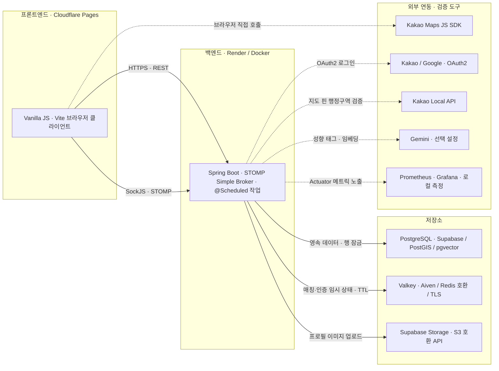

# 마주한끼 시스템 아키텍처

프로젝트의 서비스 구성과 포트폴리오의 매칭 동시성·상태 보정 사례를 연결하는 구성도입니다.

- 기준 커밋: `310120e7ba6de85c372a028935fa2b07c1621c94`
- 작성일: 2026-11-02
- 코드와 설정을 기준으로 작성했습니다. 호스팅 서비스(Render, Cloudflare Pages, Supabase, Aiven)는 저장소 README의 배포 구성을 따랐으며, 현재 운영 상태를 확인한 운영 현황도는 아닙니다.

[마주한끼 테마를 적용한 HTML 구성도 보기](majuhankki.html)

## 구성도 읽는 법

- 실선은 클라이언트·백엔드·저장소의 주요 연결, 점선은 외부 서비스와 검증 도구의 연결입니다. 점선 자체가 비동기 호출을 의미하지는 않습니다.
- Spring Boot는 하나의 백엔드 애플리케이션입니다. 인증·매칭·채팅·후기 도메인을 별도 서비스로 나누어 표시하지 않았습니다.
- 브라우저는 REST API와 별도로 `/ws-chat` SockJS·STOMP 연결을 엽니다. 채팅 메시지와 매칭 제안·결과 알림이 이 연결로 전달됩니다.

## 포트폴리오와 연결되는 설계

| 구성 요소 | 역할 | 포트폴리오 사례와 연결 |
| --- | --- | --- |
| PostgreSQL | 매칭 요청·제안·결과, 채팅방 등 영속 데이터의 기준 상태. PostGIS로 반경 후보를 찾고 pgvector에 성향 임베딩을 저장 | 사례 ①: 제안 → 요청 ID 오름차순 `PESSIMISTIC_WRITE` 잠금과 UNIQUE 제약. 사례 ②: 보정 작업의 기준 상태 |
| Valkey | 매칭 대기 키·GEO 등록·제안 상태, OAuth 일회성 교환 코드 등 짧은 수명의 상태와 TTL | 사례 ②: 누락된 대기 키를 DB 기준으로 복구하거나 만료. PostgreSQL을 대체하는 원장이 아님 |
| `@Scheduled` 작업 | 제안 만료, 제안 재시도, 대기 상태 보정, Refresh Token 정리 | 사례 ①: 만료 스케줄러도 같은 잠금 순서를 따름. 사례 ②: 대기 상태 보정 주기 |
| STOMP Simple Broker | 채팅 메시지와 매칭 제안·결과 알림 전달. 애플리케이션 메모리 안의 브로커 | 매칭 결과 알림은 DB 커밋 뒤에 전송. 알림 전달 보장이나 영속 재시도는 아님 |

## 생략한 경로와 환경 구분

- **호스팅:** Render·Cloudflare Pages·Supabase·Aiven 구성은 README의 배포 구성 표를 근거로 합니다. 저장소에는 플랫폼 설정 파일(`render.yaml` 등)이 없고, `application-prod.yml` 주석과 `Dockerfile`이 Render 배포를 전제로 합니다.
- **CI/CD:** 기준 커밋에는 GitHub Actions 워크플로가 없습니다. 배포를 어떤 방식으로 시작했는지는 저장소에서 확인할 수 없어 그림에 넣지 않았습니다.
- **프론트엔드:** 빌드 도구는 Vite이고 화면은 Vanilla JavaScript입니다. Tailwind CSS와 SockJS·STOMP 클라이언트는 CDN 스크립트로 불러옵니다. 운영에서는 `VITE_API_BASE_URL`로 백엔드를 호출하고, 개발 환경에서는 Vite 프록시가 API와 WebSocket을 백엔드로 전달합니다.
- **OAuth2:** 브라우저가 제공자 인가 화면으로 이동했다가 돌아오는 왕복은 생략했습니다. 로그인 성공 리다이렉트에는 토큰 대신 일회성 교환 코드를 담고, 이 코드를 Valkey에 짧게 저장합니다.
- **이미지 업로드:** 브라우저가 백엔드로 파일을 보내고, 백엔드가 S3 호환 API(`putObject`)로 Supabase Storage에 저장합니다.
- **Kakao 연동:** 지도 표시와 장소 검색은 브라우저가 Kakao Maps SDK를 직접 호출합니다. 백엔드는 매칭 요청을 만들 때 Kakao Local API로 지도 핀 좌표의 행정구역을 검증합니다.
- **Gemini:** `AI_CHAT_PROVIDER`·`AI_EMBEDDING_PROVIDER`의 기본값이 `none`이어서 설정했을 때만 호출합니다. AI가 꺼져 있어도 기본 매칭은 동작합니다.
- **Prometheus·Grafana:** `docker-compose.yml`로 로컬에서 실행하는 측정 도구입니다. `prod` 프로필은 Prometheus 메트릭 노출을 끄고 `health`만 공개합니다.
- **Valkey 대체:** 로컬 개발에서는 Docker의 Redis 컨테이너로 Valkey를 대신할 수 있습니다. 그림의 Valkey는 README의 배포 구성(Aiven for Valkey)을 따릅니다.
- **단일 인스턴스 전제 (코드에서 도출한 해석):** STOMP Simple Broker는 애플리케이션 메모리 안에서 동작합니다. 그래서 백엔드 인스턴스가 여러 대가 되면 다른 인스턴스에 연결된 사용자에게 메시지가 전달되지 않습니다. 이 경우 외부 메시지 브로커를 중계로 두는 구성이 필요합니다.
- **팀 구성도와의 차이:** 저장소에는 팀이 만든 구성도(`docs/assets/image/시스템아키텍쳐.jpg`)가 있습니다. 이 문서의 그림은 그 구성도를 참고하되 코드와 설정을 기준으로 다시 그렸습니다. 연결 방향, 선택 설정 여부, 로컬 전용 도구를 따로 표시했습니다.
- 구성도는 팀 전체 서비스의 맥락입니다. 개인 담당 범위는 포트폴리오의 담당 업무를 따릅니다.

## 근거

- [README 기술 스택·배포 구성](https://github.com/prgrms-aibe-devcourse/AIBE7-Project2-Team04/blob/310120e7ba6de85c372a028935fa2b07c1621c94/README.md)
- [Render용 Dockerfile](https://github.com/prgrms-aibe-devcourse/AIBE7-Project2-Team04/blob/310120e7ba6de85c372a028935fa2b07c1621c94/Dockerfile)
- [운영 프로필 설정](https://github.com/prgrms-aibe-devcourse/AIBE7-Project2-Team04/blob/310120e7ba6de85c372a028935fa2b07c1621c94/src/main/resources/application-prod.yml)
- [Valkey·Storage·매칭 주기 설정](https://github.com/prgrms-aibe-devcourse/AIBE7-Project2-Team04/blob/310120e7ba6de85c372a028935fa2b07c1621c94/src/main/resources/application.yml)
- [AI 제공자 설정](https://github.com/prgrms-aibe-devcourse/AIBE7-Project2-Team04/blob/310120e7ba6de85c372a028935fa2b07c1621c94/src/main/resources/application-ai.yml)
- [STOMP 엔드포인트·Simple Broker 설정](https://github.com/prgrms-aibe-devcourse/AIBE7-Project2-Team04/blob/310120e7ba6de85c372a028935fa2b07c1621c94/src/main/java/org/example/project2/global/config/websocket/WebSocketConfig.java)
- [Valkey 매칭 대기 저장소](https://github.com/prgrms-aibe-devcourse/AIBE7-Project2-Team04/blob/310120e7ba6de85c372a028935fa2b07c1621c94/src/main/java/org/example/project2/domain/matching/repository/RedisRealtimeMatchWaitingStore.java)
- [OAuth 일회성 교환 코드 저장](https://github.com/prgrms-aibe-devcourse/AIBE7-Project2-Team04/blob/310120e7ba6de85c372a028935fa2b07c1621c94/src/main/java/org/example/project2/domain/auth/service/oauth/OAuthAuthorizationCodeService.java)
- [Supabase Storage 업로드](https://github.com/prgrms-aibe-devcourse/AIBE7-Project2-Team04/blob/310120e7ba6de85c372a028935fa2b07c1621c94/src/main/java/org/example/project2/global/storage/S3FileStore.java)
- [Kakao Local API 행정구역 검증](https://github.com/prgrms-aibe-devcourse/AIBE7-Project2-Team04/blob/310120e7ba6de85c372a028935fa2b07c1621c94/src/main/java/org/example/project2/domain/region/service/KakaoRegionPinValidator.java)
- [프론트엔드 Kakao Maps SDK·SockJS·STOMP 로드](https://github.com/prgrms-aibe-devcourse/AIBE7-Project2-Team04/blob/310120e7ba6de85c372a028935fa2b07c1621c94/frontend/index.html)
- [로컬 Prometheus·Grafana 구성](https://github.com/prgrms-aibe-devcourse/AIBE7-Project2-Team04/blob/310120e7ba6de85c372a028935fa2b07c1621c94/docker-compose.yml)
