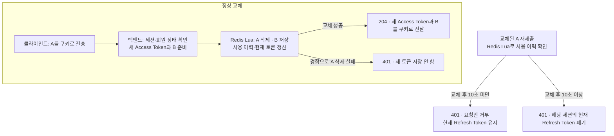
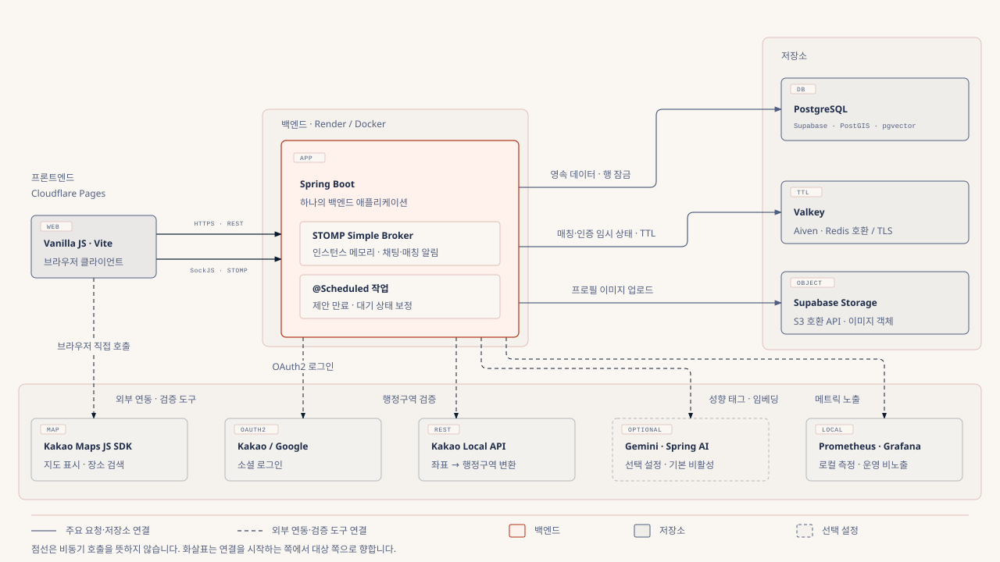

# 한재훈 포트폴리오

## 프로젝트 목차

- [GRAB · 회원 인증·성능 개선](#grab)
- [마주한끼 · 실시간 매칭·상태 보정](#majuhankki)

---

## GRAB

### 1\. 프로젝트 개요

정해진 시각에 한정 수량 상품을 판매하는 DROP 커머스 서비스입니다. WISH, 주문, 결제, 배송까지 이어지며, 오픈 시각에 요청이 한꺼번에 몰린다는 점이 서비스의 특징입니다.

| 항목 | 내용 |
| :---- | :---- |
| 기간 · 인원 | 2026.09.22 \~ 2026.11.04 (약 6주) · 4명 |
| 담당 | 회원·인증 전 영역 (설계, API, 프론트 연동, 부하 측정·개선), 백엔드 초기 환경 구성 |
| 기술 | Java 17, Spring Boot 4, Spring Security, JPA, PostgreSQL, Redis, Caffeine, React, Docker, GitHub Actions, k6 |
| 저장소 | [GitHub](https://github.com/prgrms-aibe-devcourse/AIBE7_FinalProject_Team3) |

#### 시스템 아키텍처

**핵심 성과**

- Argon2 해시의 동시 실행을 4건으로 제한해, 로그인 80명이 동시에 몰릴 때 **p95 응답시간을 26.1초에서 3.0초로, 실패를 29건에서 0건으로** 줄였습니다. 병목(해시 1건이 힙 약 19MiB를 붙잡아 동시 약 25건이 한계)은 k6 부하 테스트와 GC 로그 분석으로 찾았습니다.
- 인증 요청의 publicId → 내부 userId 매핑을 Caffeine에 캐싱하고 조회 트랜잭션을 조정해, **예열된 내 정보 조회의 추정 DB 왕복을 4.07회에서 2.01회로** 줄였습니다. 운영 DB와 비슷하도록 왕복 지연을 설정한 로컬 테스트 환경에서, 같은 VU 1600 기준으로 **처리량이 약 1.95배** 높아졌습니다.

### 2\. 담당 업무

- **인증·세션:** HttpOnly 쿠키 기반 JWT 인증과 CSRF·CORS 정책, Redis Lua 기반 Refresh Token 교체와 세션 관리(로그인, 재발급, 로그아웃)
- **회원가입·회원 정보:** 이메일 인증 회원가입, 카카오·구글 OIDC 로그인, 내 정보·프로필 이미지 API와 프론트엔드 연동  
- **성능 측정 및 개선:** k6 로그인·인증 API 부하 측정, Argon2 동시 실행 제한, 회원 ID 변환 캐시와 조회 트랜잭션 개선, 전후 재측정  
- **환경 구성:** Docker Compose 개발 환경, GHCR 이미지 배포 워크플로, 인증 API 명세

---

### 3\. 핵심 사례 ① 수많은 로그인 요청에 멈추던 서버를 Argon2 동시 실행 제한으로 안정화

**문제:** DROP 오픈 직전에 로그인이 몰리는 상황을 k6로 재현했습니다. 운영보다 약한 t3.micro 기준(메모리 1GiB, CPU 2개, 힙 550MiB)에서 로그인 80명이 동시에 몰리자 p95가 26.1초까지 늘고 29건이 실패했습니다. 힙 OOM으로 Tomcat 스레드가 죽어, 재시작 전까지 서버가 응답하지 않은 적도 있었습니다.

**원인:**

- 비밀번호 해시 Argon2id(메모리 19MiB, OWASP 최소 권장값)는 **해시 1건이 진행되는 동안 힙 약 19MiB를 붙잡습니다.** BouncyCastle 바이트코드로 확인했습니다.  
- GC 로그로 Full GC 직후 힙을 보니, 동시 해시가 **약 25건**을 넘으면 힙 한도에 닿아 Full GC가 반복되고 요청이 실패했습니다.  
- 가입 여부를 숨기려고 없는 계정도 더미 해시로 검증하므로, 틀린 비밀번호 요청도 같은 비용이 들었습니다.

**해결:** 서버를 키우거나 Argon2 메모리를 낮추는(보안 기준 위반) 대신, `PasswordEncoder`를 감싸 **해시를 동시에 4건까지만 실행**하게 했습니다.

- 처리량은 CPU가, 힙 사용은 동시 실행 수가 정합니다. 그래서 CPU 수 근처로 묶으면 처리량은 지키면서 힙 사용만 묶을 수 있다고 판단했습니다.  
- 공정 세마포어로 먼저 온 요청부터 처리하고, 3초 안에 차례가 오지 않으면 503과 `Retry-After`로 거절합니다.  
- 로그인, 더미 해시, 가입, 비밀번호 변경이 모두 같은 제한을 받으므로 거절 응답으로 가입 여부가 드러나지 않습니다.

**결과 (같은 환경·시나리오로 재측정)**

| 지표 | 개선 전 | 개선 후 |
| :---- | :---- | :---- |
| 일제히 80명 p95 응답시간 | 26.1초 | **3.0초** |
| 일제히 80명 실패 (2회 측정) | 29·32건 | **0·0건** |

**보조 검증: 반복 부하에서의 힙 사용**

micro·G1 환경에서 로그인 요청을 30초간 반복한 결과도 비교했습니다. 실제 이용 패턴과는 구분하며, 해시 연산이 계속 유입될 때 메모리 압박을 확인하는 보조 검증입니다.

VU 40 조건에서 Full GC 직후 힙은 **422MiB에서 124MiB로**, 관측 최댓값은 **544MiB에서 137MiB로** 줄었습니다. VU별 응답시간과 상세 측정 조건은 아래 개선 전·후 측정 자료에 정리했습니다.

반복 부하 VU 80의 개선 후 측정에서는 대기 한도 초과로 98건(11.6%)을 거절했습니다. 동시 실행 제한은 과부하 시 일부 요청을 거절하는 비용이 있습니다.

근거: [ConcurrencyLimitedPasswordEncoder](https://github.com/prgrms-aibe-devcourse/AIBE7_FinalProject_Team3/blob/8d82e61091fb3ac2b7a4a6bc21ea81233619086b/Backend/src/main/java/org/example/grab/global/security/password/ConcurrencyLimitedPasswordEncoder.java), [개선 전 측정](https://github.com/prgrms-aibe-devcourse/AIBE7_FinalProject_Team3/blob/8d82e61091fb3ac2b7a4a6bc21ea81233619086b/Backend/k6/login-burst/result.md), [개선 후 측정](https://github.com/prgrms-aibe-devcourse/AIBE7_FinalProject_Team3/blob/8d82e61091fb3ac2b7a4a6bc21ea81233619086b/Backend/k6/login-burst/result-gr178.md)

---

### 4\. 핵심 사례 ② 인증 요청의 반복 ID 조회를 제거해 DB 왕복을 절반으로 줄이고 처리량 1.95배 개선

**문제:** JWT에는 외부 식별자인 publicId를 넣고, 서비스와 FK에는 내부 PK인 users.id를 사용합니다. 로그인 이후에도 인증 API가 내부 ID를 얻을 때마다 같은 회원을 DB에서 다시 조회했습니다. 이 반복 비용이 실제 병목인지 확인하기 위해 기준선을 먼저 측정했습니다.

**원인:** 내 정보 조회는 ID 변환과 회원 정보 조회가 각각 별도 읽기 트랜잭션을 열었습니다. SELECT는 단순했지만 요청마다 커넥션을 두 번 빌렸고, ID 변환이 요청당 DB 왕복 약 4회 중 2회를 차지했습니다. 운영 DB와 비슷하도록 왕복 지연을 약 3ms로 설정한 환경에서는 VU 800부터 커넥션 풀이 포화되며 지연이 늘었습니다.

**해결: ID 매핑 캐시와 캐시 누락 경로 개선을 함께 적용했습니다.**

- **캐시 대상과 위치:** 변경되지 않는 publicId → 내부 userId 매핑만 Caffeine 로컬 메모리에 저장했습니다. 적중하면 ID 변환을 위한 DB 접근이 사라집니다. 원격 캐시의 네트워크 왕복도 추가하지 않습니다.
- **만료와 용량:** ID 매핑이 변경되지 않고 탈퇴 시에도 회원 행을 유지하므로 TTL·명시적 무효화를 생략했습니다. 캐시는 최대 10만 항목으로 제한하고, 없는 회원은 저장하지 않습니다. 로컬 Java 17·Caffeine 3.2.4 환경에서 10만 항목을 적재한 뒤 JOL로 측정한 캐시 객체 그래프는 약 13.45MiB로, 힙 상한 550MiB의 약 2.44%였습니다(공용 스레드풀 제외). Micrometer로 캐시 적중·누락·크기·자동 제거 횟수를 관측합니다. [메모리 측정 근거](../grab/evidence/user-id-cache-memory/result.md)
- **첫 요청 비용:** ID 변환 서비스의 읽기 트랜잭션을 제거했습니다. 캐시가 비어도 자동 커밋 SELECT 한 문장으로 조회합니다. JWT에 내부 ID를 넣는 방법은 기존 Claim 계약과 충돌해 제외했습니다.
- **회원 상태 확인:** 캐시는 ID 매핑만 보관합니다. 내 정보 조회는 계속 DB에서 회원 정보를 읽고 정지·탈퇴 상태를 확인합니다.

**검증:** PostgreSQL 로그와 pg_stat_statements로 트랜잭션 경계·문장 수를 확인하고, netem 지연 전후 응답시간 차이로 DB 왕복 수를 추정했습니다. 캐시 적중 경로에서는 ID 변환 SELECT가 사라졌고, 누락 경로에서는 별도 BEGIN·COMMIT 없이 SELECT 한 문장만 실행됐습니다.

**결과 (GET /api/v1/users/me, 같은 날 전후 교대 측정)**

| 지표 | 개선 전 | 개선 후 |
| :---- | :---- | :---- |
| 요청당 추정 DB 왕복 · 트랜잭션 | 4.07회 · 약 2개 | **2.01회 · 약 1개** |
| VU 25 응답시간 중앙값 | 18.4~18.7ms | **12.0~12.3ms** |
| VU 800 응답시간 p95 | 126.2~141.4ms | **14.1~16.7ms** |
| VU 800 커넥션 획득 평균 시간 | 24.78~27.82ms | **0.57~0.84ms** |
| VU 1600 처리량 | 763.8~769.1건/초 | **1,490.3~1,504.1건/초 (약 1.95배)** |

응답시간·처리량·DB 연결 획득 시간은 각 조건을 두 번 측정한 값의 범위입니다.

개선 후 DB 왕복·트랜잭션 수는 회원 ID가 캐시에 이미 저장된 요청 기준입니다.

**측정 조건**

- **측정 대상:** 로그인한 사용자의 내 정보 조회 API(GET /api/v1/users/me)를 비교했습니다.
- **실행 환경:** 로컬 Docker에서 백엔드는 CPU 2개·메모리 1GiB(힙 550MiB), DB는 CPU 1개·메모리 512MiB로 제한했습니다. 백엔드가 사용할 수 있는 DB 연결은 최대 10개로 설정했습니다.
- **DB 통신 지연:** DB와 통신할 때 발생하는 네트워크 비용을 반영하기 위해 netem으로 약 3ms의 왕복 지연을 적용했습니다.
- **요청 방식:** 동시에 요청을 반복하는 가상 사용자(VU)를 25명부터 1,600명까지 늘렸습니다. 각 단계는 60초간 실행했고, 각 사용자는 응답을 받은 뒤 1초 쉬고 다음 요청을 보냈습니다. 테스트 계정은 800개이며, 가상 사용자가 800명을 넘는 단계에서는 계정을 공유했습니다.
- **비교 방법:** 같은 날 같은 환경에서 개선 전 → 개선 후 → 개선 전 → 개선 후 순서로 실행해, 각각 두 번 측정했습니다.

**검증 결과:** 개선 후 교대 측정의 캐시 누락 비율은 0.32%였고, 네 실행 모두 요청 실패·401·커넥션 타임아웃은 0건이었습니다.

**해석:** 반복 ID 조회를 제거해 커넥션 점유와 대기를 줄였습니다. 낮은 부하에서 줄어든 중앙값 약 6.4ms도 제거한 DB 왕복 약 2회와 맞았습니다. 위 성과는 캐시 도입과 조회 트랜잭션 제거를 함께 적용한 결과입니다.

#### 설계 회고

이번 개선은 기존 JWT의 publicId와 내부 userId를 분리한 구조를 유지하면서 반복 조회 비용을 줄였습니다. 현재 구조를 돌아보면, 자체 발급 JWT에 내부 userId를 담아 ID 변환과 매핑 캐시 자체를 없애는 대안도 검토할 필요가 있습니다. 내부 PK 비노출 정책을 조정해야 하지만, 서비스가 사용하는 식별자와 인증 정보를 일치시켜 요청 처리와 유지보수를 단순화할 수 있습니다.

**남은 과제:** 약 1,500건/초는 이번 범위의 최고 측정 처리량이며, 개선 후 처리량 한계는 더 높은 부하에서 확인해야 합니다. 캐시는 인스턴스마다 따로 채워지므로 재기동·첫 요청·캐시 항목 자동 제거 이후의 효과는 접속 패턴에 따라 달라집니다. 같은 키의 동시 누락은 하나로 합치지 않아 중복 DB 조회가 가능하며, 회원 행 삭제나 ID 변경 정책을 도입하면 무효화 정책도 재검토해야 합니다.

근거: [UserIdLookupService](https://github.com/prgrms-aibe-devcourse/AIBE7_FinalProject_Team3/blob/7c2e51b84c45d4d31eea2e7549907d40416fc323/Backend/src/main/java/org/example/grab/domain/user/service/UserIdLookupService.java), [캐시 설정](https://github.com/prgrms-aibe-devcourse/AIBE7_FinalProject_Team3/blob/7c2e51b84c45d4d31eea2e7549907d40416fc323/Backend/src/main/java/org/example/grab/domain/user/support/UserIdCacheConfig.java), [캐시 테스트](https://github.com/prgrms-aibe-devcourse/AIBE7_FinalProject_Team3/blob/7c2e51b84c45d4d31eea2e7549907d40416fc323/Backend/src/test/java/org/example/grab/domain/user/service/UserIdLookupServiceTest.java), [측정 결과·재현 절차](https://github.com/prgrms-aibe-devcourse/AIBE7_FinalProject_Team3/blob/7c2e51b84c45d4d31eea2e7549907d40416fc323/Backend/k6/user-id-lookup/result.md), [기준선 PR #223](https://github.com/prgrms-aibe-devcourse/AIBE7_FinalProject_Team3/pull/223), [개선 PR #226](https://github.com/prgrms-aibe-devcourse/AIBE7_FinalProject_Team3/pull/226)

---

### 5\. 인증 설계·구현: Redis Lua 기반 Refresh Token Rotation 구현

재발급마다 Refresh Token을 교체하고, 이미 사용한 토큰의 재사용에 대응하는 인증 세션을 구현했습니다.

#### Refresh Token 교체와 재사용 처리

A는 사용 전 Refresh Token, B는 새로 발급할 Refresh Token입니다.

사용 이력이 없는 토큰도 401로 거부합니다. 10초가 지나는 것만으로 세션이 자동 폐기되지는 않으며, 이전 토큰이 다시 제출될 때 판정합니다.

- **원자적 교체:** 기존 토큰 삭제, 새 토큰·현재 세션 정보 저장, 사용 이력 기록을 하나의 Redis Lua 스크립트로 처리했습니다. 기존 토큰 삭제에 성공한 요청만 교체를 진행하도록 했습니다.
- **재사용 처리 정책:** 교체 후 10초 미만의 재사용은 요청만 거부하고, 10초 이상 지난 토큰이 다시 제출되면 해당 세션의 현재 Refresh Token을 폐기합니다.

**통합 테스트 구성:** Testcontainers 기반 Redis 통합 테스트에 같은 토큰의 동시 교체 20건 중 1건만 성공하는지, 유예 시간 안팎의 재사용과 세션 폐기가 정책대로 동작하는지 확인하는 시나리오를 작성했습니다.

**한계:** 재사용자의 정체를 판별하지 않으며, 10초 경과만으로 세션이 자동 폐기되지는 않습니다.

근거: [TokenRefreshService](https://github.com/prgrms-aibe-devcourse/AIBE7_FinalProject_Team3/blob/223b697783bbd712c68d359999f42ad141353802/Backend/src/main/java/org/example/grab/domain/auth/service/TokenRefreshService.java), [교체 Lua](https://github.com/prgrms-aibe-devcourse/AIBE7_FinalProject_Team3/blob/223b697783bbd712c68d359999f42ad141353802/Backend/src/main/resources/redis/refresh-token-rotate.lua), [재사용 판정 Lua](https://github.com/prgrms-aibe-devcourse/AIBE7_FinalProject_Team3/blob/223b697783bbd712c68d359999f42ad141353802/Backend/src/main/resources/redis/refresh-token-reuse.lua), [유예 설정](https://github.com/prgrms-aibe-devcourse/AIBE7_FinalProject_Team3/blob/223b697783bbd712c68d359999f42ad141353802/Backend/src/main/resources/application.yml), [통합 테스트](https://github.com/prgrms-aibe-devcourse/AIBE7_FinalProject_Team3/blob/223b697783bbd712c68d359999f42ad141353802/Backend/src/test/java/org/example/grab/domain/auth/repository/RefreshTokenRotationIntegrationTest.java), [PR \#101](https://github.com/prgrms-aibe-devcourse/AIBE7_FinalProject_Team3/pull/101)

---

### 6\. 그 밖의 작업

- **이메일 인증 무차별 대입 방지:** 코드를 비교하기 전에 Redis `INCR`로 시도 횟수를 올려, 틀린 코드를 동시에 보내도 비교는 5번만 일어나게 했습니다. ([코드](https://github.com/prgrms-aibe-devcourse/AIBE7_FinalProject_Team3/blob/223b697783bbd712c68d359999f42ad141353802/Backend/src/main/java/org/example/grab/domain/user/service/EmailVerificationService.java), [PR \#63](https://github.com/prgrms-aibe-devcourse/AIBE7_FinalProject_Team3/pull/63))  
- **카카오·구글 OIDC 로그인:** PKCE·state·nonce를 적용하고 제공자 식별자로만 회원을 찾아, 같은 이메일의 다른 계정과 자동으로 연결되지 않게 했습니다. ([코드](https://github.com/prgrms-aibe-devcourse/AIBE7_FinalProject_Team3/blob/223b697783bbd712c68d359999f42ad141353802/Backend/src/main/java/org/example/grab/domain/auth/support/oauth2/SocialAuthorizationRequestResolver.java), [PR \#126](https://github.com/prgrms-aibe-devcourse/AIBE7_FinalProject_Team3/pull/126))  
- **프로필 이미지 정합성:** 이전 이미지는 DB 커밋 뒤에만 지워, 롤백돼도 DB가 없는 파일을 가리키지 않게 했습니다. ([코드](https://github.com/prgrms-aibe-devcourse/AIBE7_FinalProject_Team3/blob/223b697783bbd712c68d359999f42ad141353802/Backend/src/main/java/org/example/grab/domain/user/service/ProfileImageCleanupListener.java), [PR \#163](https://github.com/prgrms-aibe-devcourse/AIBE7_FinalProject_Team3/pull/163))

---

## 마주한끼

### 1\. 프로젝트 개요

지역·시간·식사 취향·대화 성향을 바탕으로 오늘 함께 식사할 한 사람을 연결하는 실시간 1:1 매칭 서비스입니다. 매칭 요청, 후보 제안, 양쪽 수락, 채팅, 후기까지 이어집니다. 매칭 전 과정을 담당하며, 동시에 들어오는 응답 속에서도 매칭이 한 번만 확정되도록 하고 PostgreSQL과 Valkey의 대기 상태를 맞추는 구조를 구현했습니다.

| 항목 | 내용 |
| :---- | :---- |
| 기간 · 인원 | 2026.08.21 \~ 2026.09.03 (2주) · 2명 |
| 담당 | 실시간 매칭 전 과정 (요청, 후보 탐색, 제안, 확정, DB–Valkey 정합성), 인증·보안 기반, 성향 설문, 후기, 초기 환경 구성 |
| 기술 | Java 17, Spring Boot 4, Spring Security, JPA, PostgreSQL (PostGIS, pgvector), Valkey, WebSocket(STOMP), Spring AI, Docker |
| 저장소 | [GitHub](https://github.com/prgrms-aibe-devcourse/AIBE7-Project2-Team04) |

팀 프로젝트의 구현 설명은 기준 커밋 `310120e`를 따릅니다. 프로젝트 종료 후 추가한 2026-11-05 검증은 개인 저장소의 `ee7d2ba`를 기준으로 별도 표기했습니다. 후보 선정은 본인 구현 시점(PR #55)과 후속 팀 변경을 구분했습니다.

#### 시스템 아키텍처

**핵심 구현·검증**

- **매칭 중복 확정 제어:** 매칭 확정 경로의 잠금 순서를 **제안 → 요청 ID 오름차순**으로 통일했습니다. 프로젝트 종료 후 실제 PostgreSQL 경합 6종을 각 100회, **총 600회 검증해 중복 매칭·상태 불일치·데드락·타임아웃 0건**을 확인했습니다.
- **DB–Valkey 상태 보정:** PostgreSQL을 기준으로 누락된 Valkey 대기 정보를 복구하거나 요청을 만료시킵니다. 프로젝트 종료 후 실제 Valkey 재시작으로 정보를 유실시킨 **205건을 복구 102건·만료 103건으로 처리해 미처리 0건**을 확인했습니다.

### 2\. 담당 업무

- **실시간 매칭:** 매칭 요청·취소, PostGIS 양방향 반경 후보 탐색, 후보 제안과 수락·거절, 매칭·채팅방 생성, Valkey 대기 상태와 보정 작업 ([PR \#44](https://github.com/prgrms-aibe-devcourse/AIBE7-Project2-Team04/pull/44), [\#46](https://github.com/prgrms-aibe-devcourse/AIBE7-Project2-Team04/pull/46), [\#50](https://github.com/prgrms-aibe-devcourse/AIBE7-Project2-Team04/pull/50))  
- **인증·보안 기반:** Spring Security 설정, CSRF, Refresh Token 해시 저장·회전·재사용 탐지, 카카오 OAuth 로그인과 일회성 교환 코드 ([PR \#19](https://github.com/prgrms-aibe-devcourse/AIBE7-Project2-Team04/pull/19), [\#24](https://github.com/prgrms-aibe-devcourse/AIBE7-Project2-Team04/pull/24), [\#26](https://github.com/prgrms-aibe-devcourse/AIBE7-Project2-Team04/pull/26), [\#33](https://github.com/prgrms-aibe-devcourse/AIBE7-Project2-Team04/pull/33))  
- **성향·후기:** 식사·대화 성향 설문, 후기 작성과 다시한끼 지수 산식 ([PR \#34](https://github.com/prgrms-aibe-devcourse/AIBE7-Project2-Team04/pull/34), [\#61](https://github.com/prgrms-aibe-devcourse/AIBE7-Project2-Team04/pull/61))  
- **환경 구성:** 초기 프로젝트·도메인 구조, 환경변수 구성, Prometheus·Grafana 매칭 지표, 배포용 Dockerfile ([PR \#55](https://github.com/prgrms-aibe-devcourse/AIBE7-Project2-Team04/pull/55), [\#64](https://github.com/prgrms-aibe-devcourse/AIBE7-Project2-Team04/pull/64))

---

### 3\. 핵심 사례 ① 동시 수락·취소·만료에서 매칭 중복 확정을 제어

**위험:** 한 사용자가 매칭 제안을 수락하는 순간, 상대방이 거절하거나 대기를 취소할 수 있습니다. 응답 기한인 180초(3분)가 끝날 무렵에는 수락과 서버의 만료 처리가 겹칠 수도 있습니다. 각 작업이 서로의 처리 결과를 확인하지 않고 저장하면 취소한 제안이 매칭으로 확정되거나, 같은 제안에서 매칭이 두 번 만들어질 수 있습니다. 또한 같은 요청이 포함된 두 제안이 동시에 확정되면 한 사람이 두 매칭에 묶일 위험이 있습니다. 실제로 겪은 장애가 아니라, 설계 단계에서 예상하고 대비한 상황입니다.

**설계:**

- **잠금 순서 통일:** 모든 확정 경로가 제안 행을 먼저 잠그고, 두 요청 행을 ID 오름차순으로 `PESSIMISTIC_WRITE` 잠급니다. 요청에서 출발하는 대기 취소도 제안 경로로 넘겨 같은 순서를 따릅니다. 잠근 뒤에는 엔티티를 다시 읽어 최신 상태로 판정합니다.
- **한 트랜잭션과 DB 제약:** 양쪽이 수락하면 매칭, 참여자 2명, 채팅방을 한 트랜잭션에서 만듭니다. 매칭 테이블에는 요청 쌍과 각 요청에 UNIQUE 제약을 두었습니다.
- **충돌 응답과 화면 복구:** 같은 결정을 다시 보내면 기존 결과를 돌려줍니다. 이미 종료·만료된 제안이거나 잠금·제약 충돌이 나면 409로 응답하고, 화면은 현재 제안을 닫은 뒤 요청·제안·최근 결과를 다시 조회해 서버 상태에 맞춥니다.

**매칭 확정 처리 흐름**

> 하나의 PostgreSQL 트랜잭션: **제안 행 잠금 → 요청 두 건을 ID 오름차순으로 잠금 → 최신 상태 확인 → 양쪽 수락 시 매칭·참여자·채팅방 생성**
>
> 제안이 있는 처리 경로 기준입니다. 경합 요청은 잠금이 해제된 뒤 최신 상태로 판정하며, UNIQUE 제약으로 중복 저장을 거부합니다.

**검증과 결과 (프로젝트 종료 후)**

> **6종 × 100회 = 총 600회 검증 · 중복 매칭·상태 불일치 0건**

프로젝트 종료 후 실제 PostgreSQL에서 양쪽 동시 수락, 동일 수락 재시도, 하나의 요청을 공유하는 경쟁 제안, 수락과 거절·취소·만료의 경합 등 6종 시나리오를 각 100회 검증했습니다. 총 600회에서 중복 매칭·상태 불일치·데드락·타임아웃과 예상하지 못한 작업 오류는 관측되지 않았습니다.

별도의 잠금 제거 실험에서는 제안 잠금을 제거하면 사용자 결정이 유실됐고, 요청 잠금까지 제거하면 중복 매칭 저장 시도가 발생해 UNIQUE 제약이 이를 거부했습니다. 이를 통해 상태 전이를 보호하는 잠금과 중복 저장을 거부하는 DB 제약의 역할을 확인했습니다.

**검증 범위와 한계**

로컬 PostgreSQL의 독립 트랜잭션 두 개를 경쟁시킨 검증이며, Valkey·WebSocket은 mock을 사용했습니다. HTTP 409 응답·화면 갱신은 검증하지 않았고, 수락·만료 경합은 이미 기한이 지난 제안에서 확인했습니다. 잠금 대기 시간 상한(lock timeout)을 설정하지 않아, 장기 트랜잭션이 있을 때 대기가 길어질 수 있습니다. 대기 상한과 실패 응답 정책은 다음 개선 과제입니다.

검증 자료: [측정 보고서](https://github.com/ImJhoon/majuhankki/blob/ee7d2ba113e892bb92dd693223dcfc58d3acb95b/performance/%EB%A7%A4%EC%B9%AD_%EC%8B%A0%EB%A2%B0%EC%84%B1_%EA%B2%80%EC%A6%9D_%EA%B2%B0%EA%B3%BC.md), [600회 동시성 테스트](https://github.com/ImJhoon/majuhankki/blob/ee7d2ba113e892bb92dd693223dcfc58d3acb95b/src/test/java/org/example/project2/domain/matching/service/proposal/MatchProposalConcurrencyIntegrationTest.java), [실행 스크립트](https://github.com/ImJhoon/majuhankki/blob/ee7d2ba113e892bb92dd693223dcfc58d3acb95b/performance/run-reliability.ps1)

근거: [MatchProposalLifecycleService](https://github.com/prgrms-aibe-devcourse/AIBE7-Project2-Team04/blob/310120e7ba6de85c372a028935fa2b07c1621c94/src/main/java/org/example/project2/domain/matching/service/proposal/MatchProposalLifecycleService.java), [요청 잠금·취소 경로](https://github.com/prgrms-aibe-devcourse/AIBE7-Project2-Team04/blob/310120e7ba6de85c372a028935fa2b07c1621c94/src/main/java/org/example/project2/domain/matching/service/request/RealtimeMatchRequestService.java), [DB 제약](https://github.com/prgrms-aibe-devcourse/AIBE7-Project2-Team04/blob/310120e7ba6de85c372a028935fa2b07c1621c94/src/main/java/org/example/project2/domain/matching/entity/Match.java), [충돌 응답 변환](https://github.com/prgrms-aibe-devcourse/AIBE7-Project2-Team04/blob/310120e7ba6de85c372a028935fa2b07c1621c94/src/main/java/org/example/project2/domain/matching/service/proposal/MatchProposalInteractionService.java), [409 처리 화면](https://github.com/prgrms-aibe-devcourse/AIBE7-Project2-Team04/blob/310120e7ba6de85c372a028935fa2b07c1621c94/frontend/src/pages/matching-request.js#L592-L634), [동시성 통합 테스트](https://github.com/prgrms-aibe-devcourse/AIBE7-Project2-Team04/blob/310120e7ba6de85c372a028935fa2b07c1621c94/src/test/java/org/example/project2/domain/matching/service/proposal/MatchProposalConcurrencyIntegrationTest.java), [PR \#46](https://github.com/prgrms-aibe-devcourse/AIBE7-Project2-Team04/pull/46), [PR \#50](https://github.com/prgrms-aibe-devcourse/AIBE7-Project2-Team04/pull/50)

---

### 4\. 핵심 사례 ② DB를 기준으로 Valkey 대기 상태를 보정

**문제와 제약:** DB에 요청이 저장되어도 Valkey 등록이 누락되거나, DB에서 매칭이 확정되어도 대기 키 삭제가 실패할 수 있습니다. PostgreSQL 트랜잭션만으로 Valkey 쓰기까지 함께 커밋할 수 없으므로, 어느 상태를 기준으로 복구할지와 실패 시 처리 순서를 정해야 합니다.

**선택 이유 (사후 비교 분석):** 요청·제안·매칭은 채팅방과 후기가 참조하는 기록이며, 사례 ①의 행 잠금과 트랜잭션으로 상태 전이를 보호합니다. 반면 Valkey 대기 키는 TTL로 사라지는 것을 전제로 둔 값입니다. 그래서 두 저장소가 어긋나면 PostgreSQL을 기준으로 Valkey를 맞춥니다. 잠시 어긋날 수 있다는 비용은 남기고, 보정 작업으로 그 시간을 줄이는 구조입니다.

**설계와 구현:**

- **역할 분리:** PostgreSQL은 요청·제안·매칭을 보존하고, Valkey는 사용자별 중복 진입 방지와 TTL 5분의 대기 상태를 맡습니다.
- **최초 등록과 롤백 보상:** `SET NX`와 예약 토큰으로 사용자 키를 선점한 뒤 DB에 요청을 저장하고, DB 커밋 전에 Lua로 대기 키와 위치 등록을 함께 활성화합니다. DB가 롤백되면 요청 ID가 일치하는 키만 정리하고, 예약 해제도 토큰이 같을 때만 수행해 다른 요청의 키를 지우지 않습니다.
- **커밋 후 반영:** 제안 생성·확정·취소·대기 복귀에 따른 Valkey 갱신과 매칭 결과 WebSocket 알림은 DB 커밋 뒤에 수행합니다. 이 단계에서 Valkey 반영이 실패해도 이미 커밋된 DB 상태는 되돌리지 않습니다.
- **대기 요청 보정:** 5초 간격의 작업이 DB의 `WAITING` 요청을 100건씩 순회합니다. 요청마다 별도 트랜잭션에서 행을 잠근 뒤 대기 키와 남은 유효 시간에 따라 처리합니다.

**복구 판단 흐름**

대기 유효 시간은 매칭 상대를 기다릴 수 있는 5분입니다. PostgreSQL에 기록된 시각을 기준으로 남은 시간을 계산하며, 복구 시 5분을 새로 부여하지 않습니다.

PostgreSQL의 `WAITING` 요청 확인 → Valkey 대기 키 조회

- **Valkey 조회 실패 →** DB 상태 유지, 다음 순회에서 재시도
- **대기 키 존재 →** 현재 상태 유지
- **키 누락·대기 유효 시간 내 →** 남은 TTL로 대기 키·위치 등록 복구
- **키 누락·대기 유효 시간 초과 →** DB 요청 만료 후 Valkey 정리

**검증과 결과 (프로젝트 종료 후)**

**Valkey 중단·재시작 시나리오**

| 장애 중 | 재시작 후 보정 |
| :---- | :---- |
| 대기 요청 **205건의 DB 상태·수정 시각 유지** | 대기 유효 시간에 따라 **102건 복구 + 103건 만료**, 미처리 **0건** |

장애 중에는 DB 상태를 유지하고, 재시작 후에는 남은 대기 유효 시간에 따라 **102건을 복구하고 103건을 만료 처리**했습니다. 별도 반복 보정 실험에서도 기존 만료 시각과 DB 수정 시각이 유지됐습니다.

추가로 대기 키 삭제 시 **205건 복구**, 대기 유효 시간 초과 시 **205건 만료**를 각각 확인했습니다.

**검증 범위:** 로컬 Docker의 실제 PostgreSQL·Valkey에서 시나리오별 1회 검증했습니다. 보정 메서드를 직접 호출했으며, 운영 환경의 복구 시간과 WebSocket 알림 전달은 검증하지 않았습니다. [상세 검증 조건](https://github.com/ImJhoon/majuhankki/blob/ee7d2ba113e892bb92dd693223dcfc58d3acb95b/performance/%EB%A7%A4%EC%B9%AD_%EC%8B%A0%EB%A2%B0%EC%84%B1_%EA%B2%80%EC%A6%9D_%EA%B2%B0%EA%B3%BC.md)

최신 검증 근거: [측정 보고서](https://github.com/ImJhoon/majuhankki/blob/ee7d2ba113e892bb92dd693223dcfc58d3acb95b/performance/%EB%A7%A4%EC%B9%AD_%EC%8B%A0%EB%A2%B0%EC%84%B1_%EA%B2%80%EC%A6%9D_%EA%B2%B0%EA%B3%BC.md), [실제 Valkey 복구 테스트](https://github.com/ImJhoon/majuhankki/blob/ee7d2ba113e892bb92dd693223dcfc58d3acb95b/src/test/java/org/example/project2/domain/matching/service/request/RealtimeMatchWaitingRecoveryIntegrationTest.java), [실행 스크립트](https://github.com/ImJhoon/majuhankki/blob/ee7d2ba113e892bb92dd693223dcfc58d3acb95b/performance/run-reliability.ps1)

**한계와 다음 단계:** 두 저장소를 함께 커밋하지 않으므로 일시적인 불일치는 남고, 순회량과 장애 지속 시간에 따라 복구가 5초보다 늦어질 수 있습니다. 보정 대상은 `WAITING` 요청의 누락된 키입니다. 종료된 요청의 잔여 키는 TTL과 만료된 위치 등록 정리에 맡기며, WebSocket 알림 유실은 보정 범위에 포함되지 않습니다.

근거: [최초 등록·롤백 보상](https://github.com/prgrms-aibe-devcourse/AIBE7-Project2-Team04/blob/310120e7ba6de85c372a028935fa2b07c1621c94/src/main/java/org/example/project2/domain/matching/service/request/RealtimeMatchRequestService.java), [Valkey 대기 저장소·Lua](https://github.com/prgrms-aibe-devcourse/AIBE7-Project2-Team04/blob/310120e7ba6de85c372a028935fa2b07c1621c94/src/main/java/org/example/project2/domain/matching/repository/RedisRealtimeMatchWaitingStore.java), [커밋 후 반영](https://github.com/prgrms-aibe-devcourse/AIBE7-Project2-Team04/blob/310120e7ba6de85c372a028935fa2b07c1621c94/src/main/java/org/example/project2/domain/matching/service/request/RealtimeMatchRedisLifecycleService.java), [보정 스케줄러](https://github.com/prgrms-aibe-devcourse/AIBE7-Project2-Team04/blob/310120e7ba6de85c372a028935fa2b07c1621c94/src/main/java/org/example/project2/domain/matching/service/request/RealtimeMatchWaitingReconciliationService.java), [요청별 복구 판단](https://github.com/prgrms-aibe-devcourse/AIBE7-Project2-Team04/blob/310120e7ba6de85c372a028935fa2b07c1621c94/src/main/java/org/example/project2/domain/matching/service/request/RealtimeMatchWaitingRepairService.java), [매칭 결과 알림](https://github.com/prgrms-aibe-devcourse/AIBE7-Project2-Team04/blob/310120e7ba6de85c372a028935fa2b07c1621c94/src/main/java/org/example/project2/domain/matching/service/proposal/MatchResultCreatedEventHandler.java), [PR \#44](https://github.com/prgrms-aibe-devcourse/AIBE7-Project2-Team04/pull/44), [PR \#46](https://github.com/prgrms-aibe-devcourse/AIBE7-Project2-Team04/pull/46)

---

### 5\. 그 밖의 작업

- **양방향 조건 기반 후보 선정:** 두 사람의 거리·식사 시간 조건을 확인하고, 양방향 성향 점수 중 낮은 값을 기준으로 후보를 정렬했습니다. ([양방향 조건 필터](https://github.com/prgrms-aibe-devcourse/AIBE7-Project2-Team04/blob/310120e7ba6de85c372a028935fa2b07c1621c94/src/main/java/org/example/project2/domain/matching/service/candidate/BidirectionalCandidateSearchService.java), [본인 구현 시점의 후보 선정](https://github.com/prgrms-aibe-devcourse/AIBE7-Project2-Team04/blob/bfa2ab3198ec0638df3785c6fb122299af561d28/src/main/java/org/example/project2/domain/matching/service/proposal/MatchProposalSelectionService.java), [PR \#55](https://github.com/prgrms-aibe-devcourse/AIBE7-Project2-Team04/pull/55), [후속 팀 변경 \#74](https://github.com/prgrms-aibe-devcourse/AIBE7-Project2-Team04/pull/74))
- **후기 작성 정책과 다시한끼 지수:** 매칭 참여자만 종료 후 7일 안에 후기를 작성하도록 제한하고, DB UNIQUE 제약으로 중복 저장을 막았습니다. 소수 후기의 점수 영향을 완화하는 다시한끼 지수도 구현했습니다. ([후기 작성](https://github.com/prgrms-aibe-devcourse/AIBE7-Project2-Team04/blob/310120e7ba6de85c372a028935fa2b07c1621c94/src/main/java/org/example/project2/domain/review/service/ReviewCommandService.java), [지수 산식](https://github.com/prgrms-aibe-devcourse/AIBE7-Project2-Team04/blob/310120e7ba6de85c372a028935fa2b07c1621c94/src/main/java/org/example/project2/domain/review/service/ReviewScorePolicy.java), [PR \#61](https://github.com/prgrms-aibe-devcourse/AIBE7-Project2-Team04/pull/61))
- **OAuth 일회성 교환 코드:** 소셜 로그인 결과를 서비스 토큰으로 교환하기 위한 임시 코드를 발급했습니다. 유효 기간은 2분이며, Valkey `GETDEL`로 조회·삭제를 한 번에 수행해 한 번만 교환할 수 있도록 했습니다. ([교환 코드](https://github.com/prgrms-aibe-devcourse/AIBE7-Project2-Team04/blob/310120e7ba6de85c372a028935fa2b07c1621c94/src/main/java/org/example/project2/domain/auth/service/oauth/OAuthAuthorizationCodeService.java), [토큰 교환](https://github.com/prgrms-aibe-devcourse/AIBE7-Project2-Team04/blob/310120e7ba6de85c372a028935fa2b07c1621c94/src/main/java/org/example/project2/domain/auth/service/oauth/OAuthTokenExchangeService.java), [PR \#24](https://github.com/prgrms-aibe-devcourse/AIBE7-Project2-Team04/pull/24))
