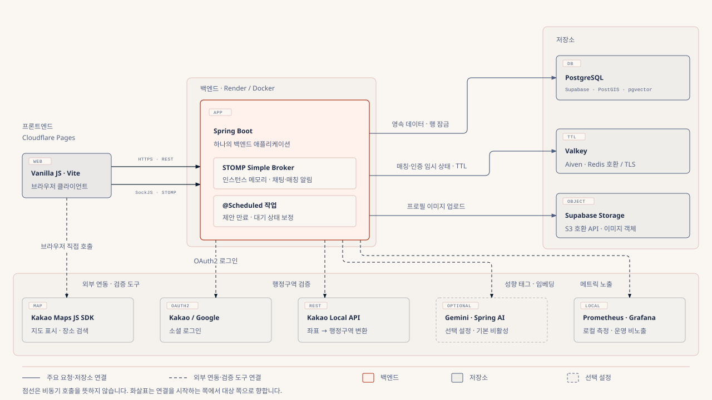

# 한재훈 | Backend Developer

Java·Spring Boot 기반으로 DB 접근 비용과 자원 사용을 분석하고, 경쟁 요청과 저장소 간 상태 불일치에 대응하는 백엔드를 구현했습니다.

[GitHub](https://github.com/ImJhoon) · [Blog](https://velog.io/@imjhoon/posts) · [E-mail](mailto:jhjh9907@gmail.com)

## 대표 문제 해결 경험

| 주제 | 구현과 검증 |
| --- | --- |
| DB 접근 비용 | 반복 ID 조회와 트랜잭션을 조정해 내 정보 조회 처리량 약 1.95배 개선. 로컬 Docker·DB 왕복 지연 약 3ms·VU 1600 기준입니다. |
| 자원 부족 대응 | Argon2 동시 실행을 제한해 일제 로그인 80건의 p95를 26.1초에서 3.0초로 개선하고, 2회 측정 모두 실패 0건을 확인했습니다. |
| 상태 복구 | PostgreSQL을 기준으로 Valkey 대기 상태를 보정했습니다. 로컬 재시작 검증에서 요청 205건을 잔여 시간에 따라 복구·만료 처리했습니다. |

[GRAB · DB 접근 비용과 자원 제어](#grab) · [마주한끼 · 상태 복구와 동시성](#majuhankki) · [개발 환경·검증 도구](#environment)

## GRAB | DB 접근 비용과 자원 제어

정해진 시각에 한정 수량 상품을 판매하는 DROP 커머스입니다. WISH부터 주문·결제·배송으로 이어지며, 판매 시작 시점에 요청이 집중되는 서비스입니다.

| 항목 | 내용 |
| --- | --- |
| 기간 · 인원 | 2026.09.22 ~ 2026.11.04 · 4명 |
| 개인 담당 | 회원·인증 설계와 API, 프론트 연동, 관련 부하 측정·개선, 백엔드 초기 환경 구성 |
| 사용 기술 | Java 17, Spring Boot 4, Spring Security, JPA, PostgreSQL, Redis, Caffeine, Docker, GitHub Actions, k6 |
| 저장소 | [팀 GitHub](https://github.com/prgrms-aibe-devcourse/AIBE7_FinalProject_Team3) |

### 01. 반복 ID 조회와 트랜잭션 경계를 조정해 DB 커넥션 대기 감소

**문제:** JWT에는 외부 식별자인 publicId를, 서비스와 FK에는 내부 userId를 사용했습니다. 내 정보 조회 시 ID 변환과 회원 조회가 별도 읽기 트랜잭션을 열어 커넥션을 두 번 빌렸습니다. DB 왕복 지연을 약 3ms로 설정한 로컬 환경에서 VU 800부터 커넥션 풀이 포화되며 지연이 늘었습니다.

**분석:** PostgreSQL 로그와 `pg_stat_statements`로 문장 수와 트랜잭션 경계를 확인했습니다. `netem` 지연 전후 응답시간 차이로 요청당 DB 왕복을 약 4회로 추정했고, 그중 약 2회가 ID 변환 경로에 해당했습니다.

**구현과 판단:**

- 변경되지 않는 `publicId → userId` 매핑만 Caffeine 로컬 캐시에 저장해 반복 SELECT를 제거하고 원격 캐시 통신도 추가하지 않았습니다. 회원 상태는 내 정보 조회에서 계속 DB로 확인합니다.
- ID 변환 서비스의 읽기 트랜잭션을 제거했습니다. 캐시 누락 시에도 별도 BEGIN·COMMIT 없이 자동 커밋 SELECT 한 문장으로 조회합니다.
- 회원 행을 유지하고 ID 매핑을 변경하지 않는 정책에 맞춰 TTL·명시적 무효화를 생략했습니다. 최대 10만 항목으로 제한하고 없는 회원은 캐싱하지 않습니다.
- Micrometer로 적중·누락·크기·자동 제거 횟수를 관측합니다. 별도 로컬 JOL 측정에서 10만 항목의 캐시 객체 그래프는 약 13.45MiB였습니다(공용 스레드풀 제외). [메모리 측정 근거](../grab/evidence/user-id-cache-memory/result.md)

**결과:** `GET /api/v1/users/me`를 같은 환경에서 개선 전 → 후 → 전 → 후로 교대 측정했습니다.

| 지표 | 개선 전 | 개선 후 |
| --- | --- | --- |
| 요청당 추정 DB 왕복 | 4.07회 | 2.01회 |
| VU 800 커넥션 획득 평균 시간 | 24.78~27.82ms | 0.57~0.84ms |
| VU 1600 처리량 | 763.8~769.1건/초 | 1,490.3~1,504.1건/초 (약 1.95배) |

**측정 조건:** 로컬 Docker에서 백엔드 CPU 2개·메모리 1GiB(힙 550MiB), DB CPU 1개·메모리 512MiB, 커넥션 풀 최대 10개로 제한했습니다. DB 왕복 지연 약 3ms, 계정 800개, VU 25~1600, 단계별 60초이며 응답 후 1초 쉬는 방식입니다. VU 800 초과 단계에서는 계정을 공유했습니다. 시간·처리량은 전후 각 2회 측정 범위이며, 개선 후 왕복 수는 캐시가 예열된 요청 기준입니다.

**해석과 한계:** 캐시와 조회 트랜잭션 조정을 함께 적용한 결과입니다. 네 실행 모두 요청 실패·401·커넥션 타임아웃은 0건이었고 개선 후 캐시 누락 비율은 0.32%였습니다. 인스턴스별 재기동·캐시 누락 시 비용은 남습니다. 같은 키의 동시 누락은 합치지 않으며, 회원 행 삭제나 ID 변경을 도입하면 무효화 정책도 재검토해야 합니다. 약 1,500건/초는 이번 범위의 최고 측정값으로, 개선 후 처리량 한계는 확인하지 않았습니다.

**설계 회고:** 기존 JWT Claim 계약을 유지하며 개선했습니다. 내부 ID를 JWT에 담아 변환과 캐시 자체를 없애는 방안도, 내부 PK 비노출 정책과 함께 재검토할 수 있습니다.

근거: [UserIdLookupService](https://github.com/prgrms-aibe-devcourse/AIBE7_FinalProject_Team3/blob/7c2e51b84c45d4d31eea2e7549907d40416fc323/Backend/src/main/java/org/example/grab/domain/user/service/UserIdLookupService.java), [캐시 설정](https://github.com/prgrms-aibe-devcourse/AIBE7_FinalProject_Team3/blob/7c2e51b84c45d4d31eea2e7549907d40416fc323/Backend/src/main/java/org/example/grab/domain/user/support/UserIdCacheConfig.java), [캐시 테스트](https://github.com/prgrms-aibe-devcourse/AIBE7_FinalProject_Team3/blob/7c2e51b84c45d4d31eea2e7549907d40416fc323/Backend/src/test/java/org/example/grab/domain/user/service/UserIdLookupServiceTest.java), [측정 결과·재현 절차](https://github.com/prgrms-aibe-devcourse/AIBE7_FinalProject_Team3/blob/7c2e51b84c45d4d31eea2e7549907d40416fc323/Backend/k6/user-id-lookup/result.md), [기준선 PR #223](https://github.com/prgrms-aibe-devcourse/AIBE7_FinalProject_Team3/pull/223), [개선 PR #226](https://github.com/prgrms-aibe-devcourse/AIBE7_FinalProject_Team3/pull/226)

### 02. 힙 사용과 GC 로그를 분석해 비밀번호 해시 동시 실행 제한

**문제:** DROP 직전 로그인 집중 상황을 로컬 부하 테스트로 재현했습니다. CPU 2개·메모리 1GiB·힙 550MiB 조건에서 80건을 동시에 보내자 p95가 26.1초로 늘고 요청이 실패했습니다. 힙 OOM으로 Tomcat 스레드가 종료되어 서버가 응답하지 않는 상황도 재현했습니다.

**분석:** BouncyCastle 바이트코드와 GC 로그를 확인했습니다. Argon2id 해시 한 건이 진행되는 동안 힙 약 19MiB를 사용했고, 동시 해시 약 25건부터 힙 한도에 닿아 Full GC가 반복됐습니다. 없는 계정의 더미 해시도 동일한 자원을 사용했습니다.

**구현과 판단:** 적용한 해시 강도를 유지하면서 `PasswordEncoder`를 감싸 동시 실행을 4건으로 제한했습니다. CPU와 메모리 제약을 함께 고려해 연산 진입을 제어했습니다.

- 공정 세마포어로 실행 기회를 배분하고, 3초 안에 획득하지 못하면 503과 `Retry-After`를 반환합니다.
- 로그인 검증·더미 해시·가입·비밀번호 변경에 같은 제한을 적용했습니다.

| 지표 | 개선 전 | 개선 후 |
| --- | --- | --- |
| 일제 로그인 80건 p95 | 26.1초 | 3.0초 |
| 일제 로그인 실패 · 2회 측정 | 29·32건 | 0·0건 |

**비용과 한계:** 같은 환경·시나리오로 재측정한 로컬 결과입니다. 30초 반복 부하의 별도 VU 40 검증에서는 Full GC 직후 힙이 422MiB에서 124MiB로 감소했습니다. 반복 부하 VU 80에서는 대기 상한 초과로 98건(11.6%)을 거절했습니다. 과부하 시에는 일부 요청을 거절해 자원 사용과 대기를 제한합니다.

근거: [ConcurrencyLimitedPasswordEncoder](https://github.com/prgrms-aibe-devcourse/AIBE7_FinalProject_Team3/blob/feat/GR-178-limit-argon2-concurrency/Backend/src/main/java/org/example/grab/global/security/password/ConcurrencyLimitedPasswordEncoder.java), [개선 전 측정](https://github.com/prgrms-aibe-devcourse/AIBE7_FinalProject_Team3/blob/feat/GR-178-limit-argon2-concurrency/Backend/k6/login-burst/result.md), [개선 후 측정](https://github.com/prgrms-aibe-devcourse/AIBE7_FinalProject_Team3/blob/feat/GR-178-limit-argon2-concurrency/Backend/k6/login-burst/result-gr178.md)

### 함께 구현한 기능

- HttpOnly 쿠키 기반 JWT 인증, CSRF·CORS 정책과 Redis Lua 기반 Refresh Token Rotation·세션 관리
- 이메일 인증 회원가입, 카카오·구글 OIDC 로그인, 회원·프로필 이미지 API와 프론트 연동
- 프로필 교체 시 이전 객체를 DB 커밋 후 정리하는 처리

[Refresh Token 교체·재사용 처리와 테스트 코드](https://github.com/prgrms-aibe-devcourse/AIBE7_FinalProject_Team3/pull/101) · [OIDC 로그인](https://github.com/prgrms-aibe-devcourse/AIBE7_FinalProject_Team3/pull/126) · [프로필 이미지 정리](https://github.com/prgrms-aibe-devcourse/AIBE7_FinalProject_Team3/pull/163)

## 마주한끼 | 상태 복구와 동시성 제어

지역·시간·식사 취향·대화 성향을 바탕으로 밥친구를 연결하는 실시간 1:1 매칭 서비스입니다. 요청·후보 제안·양쪽 수락·매칭 확정으로 이어지는 흐름을 담당했습니다.

| 항목 | 내용 |
| --- | --- |
| 기간 · 인원 | 2026.08.21 ~ 2026.09.03 · 2명 |
| 개인 담당 | 매칭 요청·후보 탐색·제안·확정·DB–Valkey 정합성, 인증·보안 기반, 성향 설문·후기, 초기 환경 구성 |
| 사용 기술 | Java 17, Spring Boot 4, Spring Security, JPA, PostgreSQL(PostGIS·pgvector), Valkey, WebSocket(STOMP), Spring AI, Docker |
| 저장소 | [팀 GitHub](https://github.com/prgrms-aibe-devcourse/AIBE7-Project2-Team04) |

### 01. PostgreSQL을 기준으로 Valkey 대기 상태 복구

**문제와 제약:** 요청·제안·매칭 기록은 PostgreSQL에, 중복 진입 방지와 TTL 5분의 대기 상태는 Valkey에 저장했습니다. 두 저장소를 함께 커밋할 수 없어 대기 키 등록 누락이나 삭제 실패로 상태가 어긋날 수 있습니다.

**구현:**

- 최초 요청은 `SET NX`와 예약 토큰으로 선점하고 DB에 저장합니다. DB 커밋 전에 Lua로 대기 키와 위치 등록을 활성화하며, 롤백 시 요청 ID가 일치하는 키만 정리하고 예약도 토큰이 같을 때만 해제합니다.
- 제안·확정·취소·대기 복귀에 따른 Valkey 갱신은 DB 커밋 뒤 실행합니다. 갱신이 실패해도 커밋된 DB는 되돌리지 않습니다.
- 5초 간격의 보정 작업이 DB의 `WAITING` 요청을 100건씩 순회합니다. 요청별 별도 트랜잭션에서 행을 잠그고 남은 대기 시간에 따라 복구·만료를 판단합니다.

| 관찰 상태 | 처리 |
| --- | --- |
| DB 대기 중 · 키 누락 · 시간 남음 | 남은 TTL로 대기 키·위치 등록 복구 |
| DB 대기 중 · 키 누락 · 시간 경과 | DB 요청 만료 후 Valkey 정리 |
| Valkey 조회 실패 | DB 상태를 유지하고 다음 순회에서 재시도 |

**설계 특성:** PostgreSQL의 영속 기록을 기준으로 TTL을 가진 대기 상태를 다시 구성합니다. 두 저장소의 일시적인 불일치는 보정 작업으로 줄입니다.

**검증 결과 — 프로젝트 종료 후:** 로컬 PostgreSQL·Valkey에서 시나리오별 대기 요청 205건과 비대기 비교 요청 4건으로 검증했습니다.

| 시나리오 | 결과 |
| --- | --- |
| 대기 키 삭제 후 보정 | 205건 복구 |
| 키 TTL 만료·DB 대기 시간 경과 후 보정 | 205건 만료 |
| Valkey 중단 중 보정 | 205건 DB 상태·수정 시각 유지 |
| Valkey 재시작 후 보정 | 102건 복구·103건 만료·미처리 0건 |
| 최초 복구 후 추가 배치 9회 | 신규 보정 0건·기존 만료 시각과 DB 수정 시각 유지 |

**조건과 한계:** Windows 로컬 Docker(PostgreSQL 17.10·Valkey 8.1.9), 명령 타임아웃 200ms에서 보정 메서드를 직접 호출했습니다. DB 기록 시각을 301초 이전으로 설정하고 Valkey 키는 실제 2초 TTL로 만료시켰습니다. 검증 버전에는 Lettuce 명령 타임아웃 반영 수정이 포함됩니다. 각 복구 시나리오는 1회 검증했으며, 실제 스케줄러의 복구 시간·WebSocket 전달은 검증 범위에 포함되지 않습니다. 보정 대상은 `WAITING`의 누락 키이며, 종료 요청의 잔여 키는 TTL과 만료된 위치 등록 정리에 맡깁니다. 전체 복구가 5초 안에 끝난다는 보장은 없습니다.

검증 자료: [측정 보고서](https://github.com/ImJhoon/majuhankki/blob/ee7d2ba113e892bb92dd693223dcfc58d3acb95b/performance/%EB%A7%A4%EC%B9%AD_%EC%8B%A0%EB%A2%B0%EC%84%B1_%EA%B2%80%EC%A6%9D_%EA%B2%B0%EA%B3%BC.md), [실제 Valkey 복구 테스트](https://github.com/ImJhoon/majuhankki/blob/ee7d2ba113e892bb92dd693223dcfc58d3acb95b/src/test/java/org/example/project2/domain/matching/service/request/RealtimeMatchWaitingRecoveryIntegrationTest.java), [실행 스크립트](https://github.com/ImJhoon/majuhankki/blob/ee7d2ba113e892bb92dd693223dcfc58d3acb95b/performance/run-reliability.ps1)

근거: [최초 등록·롤백 보상](https://github.com/prgrms-aibe-devcourse/AIBE7-Project2-Team04/blob/310120e7ba6de85c372a028935fa2b07c1621c94/src/main/java/org/example/project2/domain/matching/service/request/RealtimeMatchRequestService.java), [Valkey 대기 저장소·Lua](https://github.com/prgrms-aibe-devcourse/AIBE7-Project2-Team04/blob/310120e7ba6de85c372a028935fa2b07c1621c94/src/main/java/org/example/project2/domain/matching/repository/RedisRealtimeMatchWaitingStore.java), [커밋 후 반영](https://github.com/prgrms-aibe-devcourse/AIBE7-Project2-Team04/blob/310120e7ba6de85c372a028935fa2b07c1621c94/src/main/java/org/example/project2/domain/matching/service/request/RealtimeMatchRedisLifecycleService.java), [보정 스케줄러](https://github.com/prgrms-aibe-devcourse/AIBE7-Project2-Team04/blob/310120e7ba6de85c372a028935fa2b07c1621c94/src/main/java/org/example/project2/domain/matching/service/request/RealtimeMatchWaitingReconciliationService.java), [요청별 복구 판단](https://github.com/prgrms-aibe-devcourse/AIBE7-Project2-Team04/blob/310120e7ba6de85c372a028935fa2b07c1621c94/src/main/java/org/example/project2/domain/matching/service/request/RealtimeMatchWaitingRepairService.java), [매칭 결과 알림](https://github.com/prgrms-aibe-devcourse/AIBE7-Project2-Team04/blob/310120e7ba6de85c372a028935fa2b07c1621c94/src/main/java/org/example/project2/domain/matching/service/proposal/MatchResultCreatedEventHandler.java), [PR #44](https://github.com/prgrms-aibe-devcourse/AIBE7-Project2-Team04/pull/44), [PR #46](https://github.com/prgrms-aibe-devcourse/AIBE7-Project2-Team04/pull/46)

### 02. 잠금 순서와 DB 제약으로 매칭 상태 전이 보호

**예상한 위험:** 동시 수락, 수락·취소·만료 경합에서 결정이 덮어써지거나 한 요청이 중복 매칭될 수 있습니다. 이를 설계 단계에서 예상하고 대비했습니다.

**구현과 판단:**

- 확정 경로는 제안 행 → 요청 ID 오름차순으로 `PESSIMISTIC_WRITE` 잠금을 획득합니다. 대기 취소도 제안이 있으면 같은 경로를 따르며, 잠근 뒤 최신 상태를 다시 읽습니다.
- 매칭·참여자 2명·채팅방 생성을 한 트랜잭션으로 묶고, 요청 쌍과 각 요청에 UNIQUE 제약을 뒀습니다.
- 같은 결정을 다시 보내면 기존 결과를 반환합니다. 종료·만료·잠금·제약 충돌은 409로 응답하고 화면이 서버 상태를 다시 조회하도록 구현했습니다.

**잠금 제거 비교 — 2026-10-31:** 기존 기준 코드와 잠금을 제거한 두 버전을 로컬 PostgreSQL에서 비교했습니다. 1회는 6개 시나리오 묶음입니다.

| 조건 | 실행과 관찰 |
| --- | --- |
| 기준 코드 | 21회 모두 6개 시나리오 통과 |
| 제안 행 잠금 제거 | 10회 모두 실패. 동시 수락에서 결정 유실로 매칭 미생성·제안 PENDING 잔류 |
| 제안·요청 잠금 제거 | 10회 모두 실패. 중복 매칭 저장 시도가 발생했고 DB UNIQUE 제약이 거부 |

**해석:** 제안 잠금은 결정 유실을, 요청 잠금은 중복 매칭 시도를 제어합니다. 잠금을 제거하면 UNIQUE 제약이 중복 저장을 거부해도 정상적인 상태 전이가 완성되지는 않았습니다.

**추가 검증 — 2026-11-05, 프로젝트 종료 후:** 독립 트랜잭션 두 개를 경쟁시키는 6종 시나리오를 각 100회 실행했습니다. 총 600회에서 중복 매칭·상태 불일치·데드락·타임아웃·예상하지 못한 작업 오류가 0건이었습니다.

**조건과 한계:** 600회는 반복 횟수이며 동시 접속자 수가 아닙니다. Windows 로컬 Docker·PostgreSQL 17.10, 커넥션 풀 최대 3개·작업 스레드 2개로 검증했습니다. Valkey·WebSocket은 mock이며 HTTP 409와 화면 갱신은 실행 검증 범위에 포함되지 않습니다. 수락·만료 경합은 이미 만료된 제안에서 확인했습니다. 잠금 제거 비교는 PostgreSQL 16에서 별도로 수행했습니다. 이전 테스트 작성·실행에는 Claude Code를 활용했습니다. 현재 lock timeout을 설정하지 않아 장기 트랜잭션의 잠금 대기가 남습니다.

검증 자료: [측정 보고서](https://github.com/ImJhoon/majuhankki/blob/ee7d2ba113e892bb92dd693223dcfc58d3acb95b/performance/%EB%A7%A4%EC%B9%AD_%EC%8B%A0%EB%A2%B0%EC%84%B1_%EA%B2%80%EC%A6%9D_%EA%B2%B0%EA%B3%BC.md), [600회 동시성 테스트](https://github.com/ImJhoon/majuhankki/blob/ee7d2ba113e892bb92dd693223dcfc58d3acb95b/src/test/java/org/example/project2/domain/matching/service/proposal/MatchProposalConcurrencyIntegrationTest.java), [실행 스크립트](https://github.com/ImJhoon/majuhankki/blob/ee7d2ba113e892bb92dd693223dcfc58d3acb95b/performance/run-reliability.ps1)

근거: [MatchProposalLifecycleService](https://github.com/prgrms-aibe-devcourse/AIBE7-Project2-Team04/blob/310120e7ba6de85c372a028935fa2b07c1621c94/src/main/java/org/example/project2/domain/matching/service/proposal/MatchProposalLifecycleService.java), [요청 잠금·취소 경로](https://github.com/prgrms-aibe-devcourse/AIBE7-Project2-Team04/blob/310120e7ba6de85c372a028935fa2b07c1621c94/src/main/java/org/example/project2/domain/matching/service/request/RealtimeMatchRequestService.java), [DB 제약](https://github.com/prgrms-aibe-devcourse/AIBE7-Project2-Team04/blob/310120e7ba6de85c372a028935fa2b07c1621c94/src/main/java/org/example/project2/domain/matching/entity/Match.java), [충돌 응답 변환](https://github.com/prgrms-aibe-devcourse/AIBE7-Project2-Team04/blob/310120e7ba6de85c372a028935fa2b07c1621c94/src/main/java/org/example/project2/domain/matching/service/proposal/MatchProposalInteractionService.java), [409 처리 화면](https://github.com/prgrms-aibe-devcourse/AIBE7-Project2-Team04/blob/310120e7ba6de85c372a028935fa2b07c1621c94/frontend/src/pages/matching-request.js#L592-L634), [동시성 통합 테스트](https://github.com/prgrms-aibe-devcourse/AIBE7-Project2-Team04/blob/310120e7ba6de85c372a028935fa2b07c1621c94/src/test/java/org/example/project2/domain/matching/service/proposal/MatchProposalConcurrencyIntegrationTest.java), [PR #46](https://github.com/prgrms-aibe-devcourse/AIBE7-Project2-Team04/pull/46), [PR #50](https://github.com/prgrms-aibe-devcourse/AIBE7-Project2-Team04/pull/50)

### 함께 구현한 기능

성향 설문과 후기 작성 정책, OAuth 일회성 교환 코드 등을 구현했습니다. 후보 선정은 양방향 점수 중 낮은 값을 기준으로 정렬하도록 구현했습니다.

[후보 선정 · 본인 PR #55](https://github.com/prgrms-aibe-devcourse/AIBE7-Project2-Team04/pull/55) · [후속 팀 변경 #74](https://github.com/prgrms-aibe-devcourse/AIBE7-Project2-Team04/pull/74) · [후기 #61](https://github.com/prgrms-aibe-devcourse/AIBE7-Project2-Team04/pull/61) · [OAuth 교환 코드 #24](https://github.com/prgrms-aibe-devcourse/AIBE7-Project2-Team04/pull/24)

## 개발 환경 구성과 검증 도구

**초기 환경 구성:** GRAB에서 Docker Compose 개발 환경, GHCR 이미지 배포 워크플로와 인증 API 명세를 구성했습니다. [전체 배포 구성과 설정 근거](architecture/grab.md)

**성능 진단:** k6로 부하를 재현하고 GC 로그·PostgreSQL 로그·`pg_stat_statements`·커넥션 획득 시간을 함께 확인했습니다. 로컬 Docker의 자원 제한과 `netem` 지연 설정을 사용해 전후를 비교했습니다. [GRAB 측정 결과·재현 절차](https://github.com/prgrms-aibe-devcourse/AIBE7_FinalProject_Team3/blob/7c2e51b84c45d4d31eea2e7549907d40416fc323/Backend/k6/user-id-lookup/result.md)

**정합성 검증:** 실제 PostgreSQL의 경쟁 트랜잭션과 Valkey 컨테이너 중단·재시작을 이용한 검증 자료를 정리했습니다. [마주한끼 실행 스크립트](https://github.com/ImJhoon/majuhankki/blob/ee7d2ba113e892bb92dd693223dcfc58d3acb95b/performance/run-reliability.ps1)
