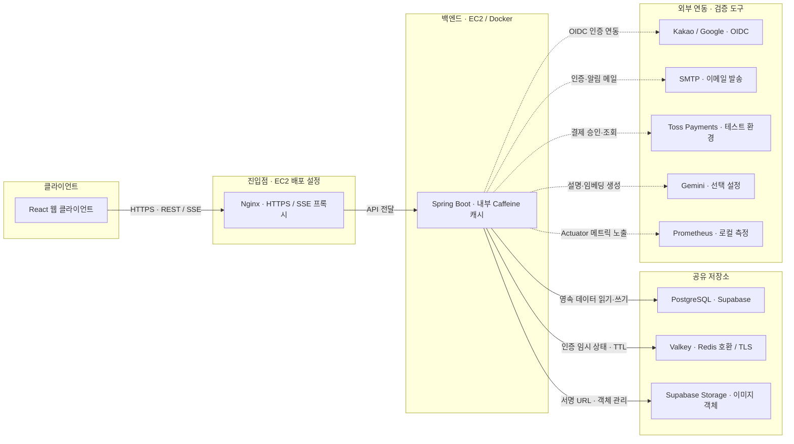

# GRAB 시스템 아키텍처

프로젝트의 서비스 구성과 포트폴리오의 인증·회원·성능 개선 사례를 연결하는 구성도입니다.

- 기준 커밋: `4bd89c4f5399a32b63b1f32bff23319619bf8466`
- 작성일: 2026-10-29
- 코드와 배포 설정을 기준으로 작성했습니다. 실제 운영 중인 인스턴스와 외부 서비스의 현재 상태를 확인한 운영 현황도는 아닙니다.

## 구성도 읽는 법

- 실선은 클라이언트·백엔드·저장소의 주요 연결, 점선은 외부 서비스와 검증 도구의 연결입니다. 점선 자체가 비동기 호출을 의미하지는 않습니다.
- Spring Boot는 하나의 백엔드 애플리케이션입니다. 인증·회원·DROP·주문·결제·배송 모듈을 별도 마이크로서비스로 나누어 표시하지 않았습니다.
- Nginx와 백엔드는 EC2 배포 설정에 포함됩니다. Blue/Green 컨테이너 중 검증한 대상을 Nginx upstream으로 선택하는 방식이며, 단일 EC2의 장애까지 방지하는 구성은 아닙니다.

## 포트폴리오와 연결되는 설계

| 구성 요소 | 역할 | 개인 사례와 연결 |
| --- | --- | --- |
| Spring Security / JWT | HttpOnly 쿠키의 Access Token을 검증하고 요청의 인증 정보를 구성 | 인증 필터의 JWT 검증과 내부 ID 변환을 구분 |
| Caffeine — 백엔드 인스턴스 내부 | `publicId → 내부 userId` 매핑을 로컬 메모리에 저장. 현재 기준 커밋에는 공개 DROP 응답 캐시도 포함 | ID 매핑 적중 시 반복 SELECT·별도 트랜잭션 비용 제거. 인스턴스마다 별도로 채워짐 |
| PostgreSQL | 회원·주문·재고·결제 등 영속 데이터의 원장 | ID 변환이 생략되어도 내 정보 조회는 DB에서 회원 상태를 확인 |
| Valkey / Redis | Refresh Token 세션·교체 이력, 이메일 인증 상태·제한, 가입 컨텍스트 등의 임시 상태와 TTL | Lua 원자 교체·재사용 판정. PostgreSQL의 대체 원장이 아님 |
| SMTP | 이메일 인증과 알림 발송 | 이메일 발송 지연·실패를 별도 실행기로 다루는 회원 기능 |
| Supabase Storage | 프로필·DROP 이미지 객체와 서명 업로드 URL | 프로필 이미지 교체 시 이전 객체를 DB 커밋 뒤 정리 |

## 생략한 경로와 환경 구분

- 이미지 업로드는 백엔드가 서명 URL을 발급한 뒤 **브라우저가 Storage로 직접 PUT**합니다. 이미지 조회도 공개 URL을 사용합니다. 위 구성도는 서버의 URL 발급·객체 관리 연결을 중심으로 단순화했습니다.
- OIDC는 브라우저의 제공자 인가 화면 이동·콜백과 서버의 토큰 교환을 포함합니다. 전체 로그인 왕복은 별도 시퀀스 다이어그램으로 설명할 수 있습니다.
- SMTP의 시연·운영 MVP 제공자는 기술 문서상 Gmail입니다. 로컬 Mailpit과 테스트 GreenMail을 운영 서버처럼 표시하지 않았습니다.
- Toss Payments는 테스트 결제 연동입니다. Gemini는 설정과 키가 있을 때만 켜지는 설명·임베딩 연동이며 기본값은 비활성입니다.
- Prometheus는 로컬 측정·검증 범위로 표시했습니다. Grafana·Loki·Alloy의 운영 구축 완료를 이 그림이 의미하지는 않습니다.
- CI/CD는 요청 처리 경로와 분리했습니다. 현재 게시 워크플로에는 `deploy` 푸시 → 이미지 빌드·GHCR 게시 → SSH를 통한 배포 스크립트 실행이 정의되어 있습니다.
- 구성도는 팀 전체 서비스의 맥락입니다. 개인 담당 범위는 인증·회원·프로필, 관련 성능 측정·개선과 초기 백엔드 환경 구성을 중심으로 설명합니다.

## 근거

- [기술 스택과 저장소·외부 연동 정책](https://github.com/prgrms-aibe-devcourse/AIBE7_FinalProject_Team3/blob/4bd89c4f5399a32b63b1f32bff23319619bf8466/Backend/docs/development/TECHSTACK.md)
- [운영 컨테이너 구성](https://github.com/prgrms-aibe-devcourse/AIBE7_FinalProject_Team3/blob/4bd89c4f5399a32b63b1f32bff23319619bf8466/Backend/deploy/compose.prod.yaml)
- [Nginx HTTPS·SSE 프록시 설정](https://github.com/prgrms-aibe-devcourse/AIBE7_FinalProject_Team3/blob/4bd89c4f5399a32b63b1f32bff23319619bf8466/Backend/deploy/nginx/grab.conf)
- [백엔드 이미지 게시·배포 워크플로](https://github.com/prgrms-aibe-devcourse/AIBE7_FinalProject_Team3/blob/4bd89c4f5399a32b63b1f32bff23319619bf8466/.github/workflows/publish-backend.yml)
- [회원 ID 매핑 캐시](https://github.com/prgrms-aibe-devcourse/AIBE7_FinalProject_Team3/blob/4bd89c4f5399a32b63b1f32bff23319619bf8466/Backend/src/main/java/org/example/grab/domain/user/service/UserIdLookupService.java)
- [프로필 이미지 서명 URL 발급](https://github.com/prgrms-aibe-devcourse/AIBE7_FinalProject_Team3/blob/4bd89c4f5399a32b63b1f32bff23319619bf8466/Backend/src/main/java/org/example/grab/domain/user/service/ProfileImageUploadService.java)
